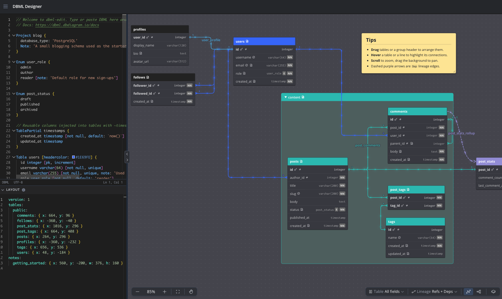

# DBML Designer

A single-page DBML editor and diagram in the spirit of [dbdiagram.io](https://dbdiagram.io). Type or paste [DBML](https://dbml.dbdiagram.io/docs) on the left and the entity-relationship diagram on the right updates as you type.

Everything runs in the browser: no accounts, no server. Your text and layout are kept in `localStorage`, and export as one `.dbml` file that carries the layout in a comment at its end.

The repository holds two npm workspace packages: the diagram engine (`packages/engine`, [its README](packages/engine/README.md)), which draws a diagram from a plain JSON model and knows nothing of DBML, and this editor (`packages/editor`), which converts DBML to the engine's model and runs on the engine. Other programs, such as a run or provenance inspector, can use the engine directly.



## Features

### Editor

- Monaco editor with DBML highlighting, completions, go-to-definition, and inline diagnostics from the official `@dbml/parse` compiler.
- An Errors button appears above the zoom buttons while the DBML has errors or warnings, and toggles a floating list of them like dbdiagram's. Click an entry to jump to it; entries with explanations or quick fixes expand in place. While the DBML has errors, the diagram keeps showing the last valid schema.
- Click a table in the diagram to reveal its declaration in the editor.
- A thin handle between the panes resizes them. Its chevrons hide the editor (`<`) or show and widen it (`>`).
- A collapsible Layout panel under the editor, closed by default, shows the layout as read-only YAML, exactly what Export writes into the footer comment at the end of the file. It follows the diagram as you arrange it, and the handle above it resizes it like the one between the panes.

### Diagram

- Tables with fields and key icons (composite keys and partial-injected fields included), header colors, collapsible table groups, and Markdown sticky notes. Notes paint above everything, then tables in no group, then collapsed groups, then open groups with their members, so a large group never hides what lies across it.
- Relationships drawn with crow's-foot ends. Lines leaving the same field share one anchor, and each line takes the color of the table it points to.
- Partial refs as badges: a ref declared on a field that a `TablePartial` injects is shown as a `~partial` badge in the table's header instead of a line, one badge per partial, so tables keyed by a shared partial (for example `~per_config`) no longer fan out to the same hub tables. Hovering a badge draws its refs with the marching ants, lights up the tables and fields they reach, and opens a tooltip with the refs, their cardinalities, and the partial's key columns; clicking it keeps them drawn. Refs declared on the table itself or in `Ref:` blocks are drawn as before. Badges show at every detail level and in Deps mode too, so the grain stays visible, and work for partials imported with `use`. The puzzle button in the bottom toolbar, between the Table and Lineage menus and always shown, draws partial refs as lines instead; hand-drawn routes of partial refs are kept while they are badges.
- Data lineage: `Dep` blocks and inline `dep` settings draw one dashed curve per pair of tables. Hovering it lists the column mappings; hovering a mapped field draws that field-to-field arrow.
- Three detail levels (all fields, keys only, table names) and light and dark themes.
- Hover a table, field, or line to highlight its connections with a marching-ants effect, the line's name, and its cardinalities. Click to pin, or turn on Highlight Relationships to animate every connection.
- Tooltips styled like dbdiagram's popovers, with sections for notes, enums, defaults, indexes, checks, metadata, relationship rules, and column-level lineage. They open beside a table or field and trail the cursor along a line.

### Arranging

- Drag tables, notes, or a whole group by its header, snapped to an 8px grid. Resize notes from their corner.
- Drag on the empty canvas to select; the selected tables and notes move together. Shift-click or Cmd-click adds or removes one.
- Drag with the middle mouse button, or hold Space and drag, to move the canvas around. Scroll to zoom.
- Lineage Layout shows only the tables that take part in `Dep` lineage, arranged in dependency order with upstream on the left.
- Arrange, in the View menu, lays out the active view in one step, made for pipeline models with one table group per stage. Each group becomes a column, ordered left to right by the `Dep` edges between their members with declaration order breaking ties, and inside a group the tables are layered by the `Dep` edges among them, so every lineage arrow points left to right unless a cycle forbids it. A table in no group sits where its lineage puts it, between the groups it connects; tables with neither a group nor lineage are packed at the right, followed by the sticky notes. Within a layer, tables with the same header color stay together, in the order the colors first appear from the left, so a color reads as a row across the stages; after that they follow their upstream tables to cut crossings. Refs play no part. Only what the view shows moves: hidden tables and notes stay put, collapsed groups stay collapsed and take only their box's room, and hand-drawn routes between moved tables go back to automatic. The same DBML always gives the same positions on the 8px grid. They land in the active view's layout and in the footer on save like a manual arrangement, including overrides for tables imported from other files, and the view is fitted to the result.
- Arrange new tables places only the tables auto-placement put down since the file was opened, which land packed at the right edge whatever their group: each goes where Arrange would put it next to its group or lineage neighbours, and nothing else moves.
- Undo arrange takes the last arrangement back in one step, from the View menu, from the Undo link in the notice that follows an arrangement, or with ⌘Z (Ctrl+Z) while no text field or editor has focus. It is offered until something in that view's layout changes again.
- Click a relationship to reroute it: drag a control point to move a segment, drag the mid-point between two points to add a bend, and reset to return to the automatic route.

### Colors and views, written back into the DBML

- A gear on a hovered table, group, or note, or on a selected relationship, opens dbdiagram's color picker. The choice becomes a `headercolor` or `color` setting in the text as one undoable edit. An inline `ref:` is moved to a `Ref:` line first, since inline refs cannot carry settings.
- The Diagram Views panel, modelled on dbdiagram's, toggles tables and notes on and off in a tree grouped by schema or table group, with search, visible/total counts, and an eye per row. Named views are `DiagramView` blocks in the text: the View menu at the right of the header, titled like the toolbar's pickers, lists them after Default with a check on the active one, plus New View, Rename, and Delete for the active one, and Arrange for its layout; the button beside it is the only way to show or hide the panel. New View and Rename open the panel with its name form, and Reset discards the toggles made there since the view was picked; in the panel's title row, Save or Save as New write the visible set back into the DBML. A view lists what it shows, so it cannot hide every table or every note. Each named view has an arrangement of its own: it starts out looking like the Default View, and tables moved, groups folded, or routes drawn while it is active belong to that view alone, while the rest keeps following the Default View.

### Toolbar and menu

- Bottom toolbar: zoom and fit on the left; the Table menu, the partial refs toggle (badges or lines), the Lineage menu, Highlight Relationships, and Lineage Layout, whose tooltip marks it (WIP) while it settles, on the right. Every menu in the app, from the hamburger to these two pickers, shares one look.
- The menu at the top left holds Export, Import, Load Example, the light/dark switch, and a link to the DBML docs. Export downloads `<project>.dbml` with the layout in a comment at the end. Import reads any `.dbml`; if it ends with such a comment, the layout is lifted out and applied to the diagram. Load Example replaces the text and layout with the starter blog schema, arranged.

## Layout comment

DBML holds the schema and the presentation the spec allows in the text: `headercolor` on tables, `color` on groups, refs, and notes, `Note` documentation, and `DiagramView` blocks. Everything else about a diagram has no place in the spec, so Export writes it as YAML inside a multi-line comment at the very end of the `.dbml`. DBML ignores comments, so the file stays valid for any DBML tool, and one file carries both the schema and its layout (the file name comes from the `Project`, else `schema`):

```dbml
Table users { id int [pk] }
Table posts { id int [pk]  author_id int [ref: > users.id] }

/* === DBML DESIGNER FOOTER ===
version: 1
views:
  default:
    tables:
      public:
        posts: { x: 0, y: 64 }
        users: { x: 288, y: 0 }
    notes:
      tips: { x: 800, y: 0, w: 192, h: 160 }
    groups:
      public:
        content: { collapsed: true }
    refs:
      - from: users(id)
        to: posts(author_id)
        rails: [ 264.5, 72, 320 ]
  overview:
    tables:
      public:
        posts: { x: 0, y: 200 }
    groups:
      public:
        content: { collapsed: false }
*/
```

- The Layout panel under the editor is a read-only preview of this YAML and follows the diagram as you arrange it.
- Import and Follow lift the footer out of the file, check it against the schema, apply it to the diagram, and show the text without it; Export and Save write it again at the end. Footer blocks are removed wherever they sit, so text that grew past an old footer never carries two. Entries for tables, notes, groups, or relationships the DBML does not have are ignored and counted in the status line; a footer that is not valid layout YAML is reported and skipped.
- Positions are diagram pixels. Tables and groups are nested under their schema; notes are keyed by name.
- A ref is identified by its optional `name` and its two ends, written like DBML as `table(fields)` with the schema left out when it is `public` (`sales.orders(id)` otherwise). The referenced table comes first: an inline `ref: > users.id` on `posts.author_id` is `from: users(id)`, `to: posts(author_id)`.
- `rails` are the alternating x, y, x, ... coordinates of the movable segments of a hand-drawn route.
- `views` holds one entry per view. `default` is the Default View, the arrangement of the whole diagram; every other entry is named after a `DiagramView` and holds the same `tables`, `notes`, `groups`, and `refs` with only what that view changes against the Default View: tables it moves, groups it folds (`collapsed: true`) or unfolds (`collapsed: false`), routes it draws or resets (`rails: []`). A view that changes nothing is left out, and renaming or deleting a view in the DBML renames or drops its entry. Older footers with the element sections at the root are read as the Default View and rewritten on the next save.
- A file that imports others inherits their layouts: an imported table sits where the footer of the file that brought it in puts it (the nearest import wins when several say something), and this file's footer records only its own elements and what it changed. The same goes for views: what an imported footer's entry for a view of the same name says sits above this file's Default View, and this file's entry for that view records only what it changes on top. A moved imported table is written with its new position; an inherited collapse that was opened is written as `collapsed: false`, and an inherited hand-drawn route that was reset as `rails: []`. Opening the imported file on its own still shows its own arrangement, and nothing is ever written to it from here.
- Empty sections are left out. The layout is kept in `localStorage` between sessions, so the exported file is for sharing and versioning.

## Development

```bash
npm install
npm run dev
```

Run everything from the repository root; `npm install` links the two workspace packages. The dev server listens on all interfaces on port 5173, so it is reachable locally at `http://localhost:5173` and by teammates on the same network at `http://<your-machine-ip>:5173` (Vite prints the Network URL on start). Vite's host check allows IP addresses, `localhost`, and `.local` Bonjour names; add other hostnames to `server.allowedHosts` in `packages/editor/vite.config.ts`. macOS may ask once to allow incoming connections for `node`. The editor reads the engine's source, so a change to the engine reloads like any other.

Other scripts:

| Command | What it does |
|---|---|
| `npm test` | Unit and component tests with Vitest, for both packages |
| `npm run type-check` | `vue-tsc` for the engine and the app, `tsc` for the command line |
| `npm run lint` | ESLint over both packages, including the rules that keep the engine free of DBML and each package to the dependencies it declares |
| `npm run build` | Type-check and produce a production build of the editor in `packages/editor/dist/` |
| `npm run preview` | Serve the production build locally |

## Following files

To work on `.dbml` files together with another program, an agent or an editor, the app follows them from disk instead of importing them. Point the dev server at the folder in `.env.local` (colon-separated for several) and restart it:

```bash
DBML_ROOTS=/Users/me/pipeline-wiki:/Users/me/other-repo
```

The name next to the title is the current file; click it for every `.dbml` directly under those folders and switch by picking one; files are created outside the app, by you or the agent, and the list refreshes each time it opens. The first file is followed automatically, and the choice is remembered. Every change written to the current file appears within a second while the layout you arranged stays put; the arrow next to the name reads the file and its imports from disk again on demand, and with unsaved edits it offers the disk text instead of dropping them. ⌘S (Ctrl-S) writes the text and the layout footer back; the status after the name says whether you have unsaved changes, and switching files saves them first. Each file keeps its own arrangement: switch away and back, saved or not, and its tables sit and its groups fold the way you left them. A footer someone else wrote to the file meanwhile wins, since that is their layout; a footer that merely disappeared does not. If the file changes on disk while you have unsaved edits, a bar above the editor offers to reload from disk or overwrite with yours, and a save that would clobber someone else's write is refused the same way.

A followed file can `use` others. DBML's [module system](https://dbml.dbdiagram.io/syntax/module-system) resolves `use * from './schema'` relative to the followed file, so a `pipeline.dbml` can import a `schema.dbml` next to it: the imported tables appear in the diagram, refs and `Dep` blocks may cross files, and changes to the imported files are picked up too. Imported elements are shown but not edited from here; problems in them are listed with the file's name. Without a followed file the text has no folder, so imports cannot resolve and the Errors list says so.

Following works through the dev server only; without `DBML_ROOTS` it reaches the `.dbml` files in this repo. The bridge reads and writes only `.dbml` files directly under the roots, from the same origin, and reports changes to every followed and imported file over a single event stream, so a file with many imports does not run the browser out of connections. Remember the dev server listens on the network, so keep the roots to what you mean to share.

## Working with an agent

Following files and the command line together let an agent write the DBML while you watch the diagram and arrange it. Using `~/github/pipeline-wiki` as the repo the model lives in:

1. Point the dev server at that repo, once, and restart it:

   ```bash
   echo 'DBML_ROOTS=/Users/me/github/pipeline-wiki' > .env.local
   ```

   Colon-separate several folders if the agent should also reach the repos being modeled.

2. Create `schema.dbml` in that folder if it does not exist yet, even empty, then in DBML Designer click the file name next to the title and pick it. The first ⌘S writes the layout footer into it.

3. Start the agent in that repo and give it the instructions as the first prompt, rather than through a `CLAUDE.md`, so they travel with the task:

   ```markdown
   The model lives in schema.dbml. DBML spec: ~/github/dbml/dbml-homepage/docs/docs.md
   and ~/github/dbml/dbml-homepage/docs/syntax/. Edit the DBML with normal file edits;
   a human watches the diagram live and arranges it.

   After every edit run this and fix what it reports before moving on:
     npm run --prefix ~/github/dbml-edit check -- $PWD/schema.dbml
   To read the model back as data:
     npm run --prefix ~/github/dbml-edit graph -- $PWD/schema.dbml --text

   Conventions: one Table per dataset, schemas for systems (kafka.events, s3.raw_orders);
   Dep blocks for lineage with column mappings; Note for what a table is and where it
   comes from; Metadata for owner, repo, schedule; TableGroup per stage; a DiagramView
   per pipeline. Never edit or remove the /* === DBML DESIGNER FOOTER === ... */ comment
   at the end; it holds the human's layout.
   ```

Each write the agent makes lands in the diagram within a second. You arrange, press ⌘S, and both of you commit the one file.

## Command line

Two commands expose what the app knows about a `.dbml` file, for scripts and for an agent that writes DBML and needs feedback without a browser:

```bash
npm run check -- path/to/schema.dbml
```

`check` prints the same errors and warnings the Errors button shows, plus the diagram adapter's warnings (duplicate refs, view entries that resolve to nothing) and any problems in the layout footer, as `file:line:col: severity: message`. `use` imports resolve next to the file on disk, and a problem inside an imported file is printed with that file's path. It exits 1 when there are errors, 0 otherwise, and takes several files at once.

```bash
npm run graph -- path/to/schema.dbml
npm run graph -- path/to/schema.dbml --text
```

`graph` prints the diagram engine's model of the file (`packages/engine/src/model.ts`): the JSON a program would hand the engine to draw the same diagram, with names resolved to keys and `TablePartial`s spliced into the tables that inject them. In declaration order it holds the project, tables with their fields, indexes, and partials, refs with both ends and cardinalities, `Dep` edges with their column mappings (one per edge, carrying its block's name, color, note, and metadata), groups, sticky notes, views, and enums. JSON by default, or with `--text` a compact listing of the model as the engine resolves it, with each table's group and the `Dep` edges between two tables folded into one. Refs that a `TablePartial` brings carry its name, `"viaPartial": "per_config"` in the JSON and `(from partial per_config)` in the listing, so they can be told apart from refs declared on a table. It refuses a file with errors and prints them instead. The DBML text stays the source of truth; these commands only read it.

## Layout of the code

Two npm workspace packages under `packages/`, with the shared tooling (ESLint, the Vitest workspace) at the root. Each package imports only what its `package.json` declares, which a lint rule enforces since npm hoists every dependency to the root.

`packages/engine` (`@dbml-designer/engine`) is the diagram engine (issue #8). It knows no DBML, editor, or file; everything else reaches it through `src/index.ts`, or `src/core.ts` (no components, so it loads in Node too). See [its README](packages/engine/README.md) for the model and the API.

- `src/model.ts` is its input, a diagram's content as plain JSON, and `src/fromModel.ts` indexes that into the view model it draws.
- `src/engine/` holds one engine's state, created per instance: `createEngine()` (`engine.ts`) ties a model, its views, its layout, and display options together; `layout.ts` and `layers.ts` are the layout layers with their inheritance, arranging, and taking it back; `views.ts` is the active view.
- `src/components/EngineDiagram.vue` draws one engine; the other components are the SVG nodes. `src/geometry/` holds framework-free layout, routing, and marker math, `src/state/` the Vue composables for pan, zoom, drag, hover, and tooltips.
- Tests that describe their diagram in DBML get it through `#dbml-testing`, which only the engine's test configuration maps, to the editor's adapter.

`packages/editor` (`@dbml-designer/editor`) is this app, its command line, and the dev-server plugin.

- `src/dbml/` converts DBML to the engine's model: `toModel.ts` resolves names and aliases, splices in `TablePartial`s, and keeps each element's place in the text as its `source`, and `buildModel.ts` hands the result to the engine.
- `src/editor/` wraps Monaco and registers the DBML language services.
- `src/layout/` is the layout in a `.dbml`: its YAML format and writer, the validator that turns imported YAML into diagnostics and a snapshot, the comment handling that puts it into and lifts it out of a file, and the import/export composable.
- `src/cli/` is the pure logic behind the `check` and `graph` commands; `cli/` is their Node entry point.
- `plugins/fileBridge.ts` is the dev-server side of following a file; `src/files/` is its browser client and `src/stores/fileLinkStore.ts` the state around it.
- `src/stores/` holds Pinia stores for the editor text, the compiler state, and UI preferences. `engineStore.ts` holds the editor's one engine, fed the converted DBML, the footers of imported files, and the UI preferences, with its layout and active view persisted; the layout and view stores wrap its state.
- `src/components/` is the app shell: header, split panes, the Errors list, the Diagram Views panel, the shared menu pieces under `common/`, and the diagram pane.
- `src/sample/` holds the starter schema and the Load Example schema, plus two models to try things on: `grain.dbml` (8 tables keyed by shared `TablePartial`s, the example from the partial-badge and arrange issues) and `synthetic.dbml` (150 tables in 8 groups joined by 400 `Dep` edges, for checking speed).

## Licensing

Apache-2.0. The editor half is adapted from the `dbml-playground` app in [holistics/dbml](https://github.com/holistics/dbml), also Apache-2.0; see `NOTICE` for the list of adapted files. The diagram renderer is original work whose dimensions and colors were chosen to resemble dbdiagram.io.
